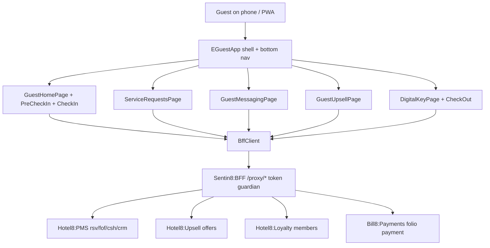

# Hotel8:eGuest

## 1. Summary

Hotel8:eGuest is the guest's in-stay companion app - a Flutter application
covering the stay journey from pre-arrival through post-stay: mobile
check-in/out, folio review and payment, service requests, front-desk
messaging, digital key management, upsell offers, and loyalty visibility. It
is a thin client over the Hotel8:PMS front-office/cashiering proxy surfaces
(`fof`, `csh`, `rsv`, `crm`) plus the Upsell, Payments and Loyalty proxies,
all through Sentin8:BFF.

## 2. Motivation

Guest expectations are set by consumer apps: they want to check in from the
taxi, message the front desk, order room service, and check out without
queueing. eGuest gives hotel8 that mobile-first surface natively against
PMS front-office records instead of a bolt-on vendor app - pre-check-in
writes the registration card, service requests land in the PMS work queues,
messaging threads ride the PMS message rows, and digital keys are issued and
activated through the PMS key domain (with the kiosk as the fallback for
properties without mobile locks).

## 3. Architecture & High-Level Design

One shell, one client, ten screens. Models cover the stay aggregate
(`StayInfo`, `Folio`, `DigitalKey`), guest interactions (`ServiceRequest`,
`Message`, `UpsellOffer`), and profile/loyalty projections. There is no local
persistence; every screen reflects server state at entry.

## 4. Key Traits and Data Structures

* `BffClient` - typed wrappers over the guest-relevant proxy endpoints;
  `BffException` for failures; same-origin base URL resolution on web.
* `StayInfo` + `StayStatus` - the reservation/stay projection driving the
  home screen and journey gating (pre-arrival → in-house → departed).
* `Folio` / `FolioItem` - the cashiering projection for folio review and
  express check-out; payments are posted via the payments proxy.
* `DigitalKey` + `DigitalKeyStatus` (`inactive`/`active`/`expired`/`revoked`)
  - key lifecycle rendered from the PMS key rows, with activate/deactivate
  actions.
* `ServiceRequest` + `ServiceRequestType`/`Status` - the request lifecycle
  (open → in progress → completed) the guest tracks.
* `UpsellOffer` + `OfferStatus` (`available`/`accepted`/`declined`/`expired`)
  - the upsell funnel with accept/decline actions.
* `GuestProfile`, `LoyaltyInfo`, `LoyaltyTransaction`, `StayRating` - profile,
  loyalty, and post-stay feedback projections.

## 5. Rationale, Trade-offs, and Alternatives

* **Companion, not booking engine** - eGuest starts from an existing
  reservation (booked via eBooking or the front desk). Rejected: adding a
  booking funnel here (duplicates eBooking and dilutes the in-stay focus).
* **BFF-only egress** - same as the other hotel8 apps; session custody and
  guest scope enforcement live server-side. Rejected: direct PMS calls (even
  read-only) which would bypass guest-level access control.
* **Guest identity via reservation + profile, not anonymous sessions** - the
  journey screens are scoped to `guest_id`/`stay_id` resolved server-side;
  the app never guesses tenant context.
* **Digital key as a PMS-domain record first** - the app renders key state
  and triggers activation; BLE/NFC lock handoff is a device concern layered
  on top, which keeps lock-vendor specifics out of the app core.
* **Plain `http` client + shell state** - journey screens are
  list-detail-action flows; no cross-screen store needed.

## 6. Internal Implementation & Invariants (Private Design)

* **Invariants:**
  * Every path constant is rooted in `/proxy/` (`pms/{rsv,fof,csh,crm}`,
    `ups`, `payments`, `loyal`, `post` proxies).
  * Stay-scoped endpoints always qualify the stay (`stay_id=...` query or
    path id) - no implicit "current stay" on the client.
  * Non-2xx ⇒ `BffException`; screens render errors from the message.
  * Key state changes are round-tripped through the PMS endpoints
    (`activate`, `{id}/deactivate`) - the client never marks a key active
    locally.
  * Models round-trip; request classes (`PreCheckInRequest`,
    `CheckInRequest`, `CheckOutRequest`) exist in `models.dart` alongside
    their responses.
* Screens own their fetch-on-entry; the shell does not pre-fetch journey
  data (a stale folio is worse than a refetch).

## 7. Unresolved Questions / Future Designs

* Guest sign-in/session bootstrap: the current client assumes a resolved
  guest context; wiring the shared auth provider (or BFF session) is the
  bootstrap gap before real guests can use it.
* Notification-driven entry points (check-in reminder, room ready, order
  status) ride on Sentin8:Post push; deep-link routing into journey screens
  is not wired yet.
* BLE/NFC lock integration and "Collect Your Key" kiosk handoff depend on
  the lock-vendor integration and eKiosk QR round-trip.
* Room-service/F&B ordering (POS proxy) is designed-for but not yet surfaced
  in a screen.

---

**Design attribution:** hotel8:eguest and its underlying concepts were designed by Hamid Jahanzad <Hamid@Jahanzad.com>.
